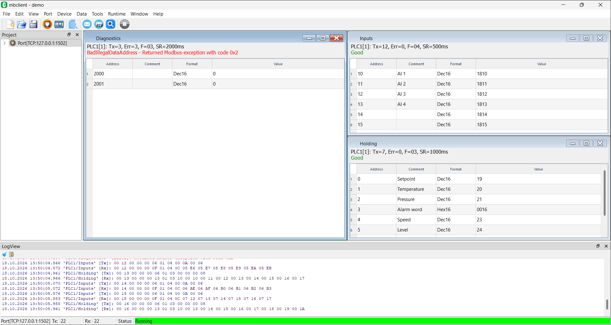

# Modbus Tools

## Overview

ModbusTools are cross-platform (Windows, Linux) graphical simulators (client/server) that support 
TCP, UDP, RTU, ASCII, RTU/ASCII over TCP/UDP Modbus protocol types. 
Modbus tools are a free, open-source  tools with a simple user interface written in C++/Qt. 

Supported Modbus functions:

* `1 ` (`0x01`) - `READ_COILS`
* `2 ` (`0x02`) - `READ_DISCRETE_INPUTS`
* `3 ` (`0x03`) - `READ_HOLDING_REGISTERS`
* `4 ` (`0x04`) - `READ_INPUT_REGISTERS`
* `5 ` (`0x05`) - `WRITE_SINGLE_COIL`
* `6 ` (`0x06`) - `WRITE_SINGLE_REGISTER`
* `7 ` (`0x07`) - `READ_EXCEPTION_STATUS`
* `8 ` (`0x08`) - `DIAGNOSTICS` (v0.5+)
* `11` (`0x0B`) - `GET_COMM_EVENT_COUNTER` (v0.5+)
* `12` (`0x0C`) - `GET_COMM_EVENT_LOG` (v0.5+)
* `15` (`0x0F`) - `WRITE_MULTIPLE_COILS`
* `16` (`0x10`) - `WRITE_MULTIPLE_REGISTERS`
* `17` (`0x11`) - `REPORT_SERVER_ID` (v0.4+)
* `20` (`0x14`) - `READ_FILE_RECORD` (v0.5+)
* `21` (`0x15`) - `WRITE_FILE_RECORD` (v0.5+)
* `22` (`0x16`) - `MASK_WRITE_REGISTER` (v0.3+)
* `23` (`0x17`) - `READ_WRITE_MULTIPLE_REGISTERS` (since v0.3)
* `24` (`0x18`) - `READ_FIFO_QUEUE` (v0.5+)
* `43/14` (`0x2B/0x0E`) - `READ_DEVICE_ID` (v0.5+)

ModbusTools work with Qt Framework version 5 (5.8 or later).
It based on `ModbusLib` cross platform library project:

<https://github.com/serhmarch/ModbusLib>

> **About this fork**
>
> This repository (<https://github.com/joraguero/ModbusTools>) is a fork of
> <https://github.com/serhmarch/ModbusTools>. It uses the ModbusLib fork
> <https://github.com/joraguero/ModbusLib> (branch `dtr-enable`) as its `modbus` submodule.
> See [Fork changes](#fork-changes) for what is different from the original project.

## Support

If ModbusTools helps you with your work and you find these programs useful,
please consider supporting its continued development:

<https://www.patreon.com/c/serhmarch>

Thank you for your support.

## Release

All compiled binaries of the original project are located in its latest release:

https://github.com/serhmarch/ModbusTools/releases

This fork provides binary versions: 
https://github.com/joraguero/ModbusTools/releases

Build it from the source code, as described in [src/README.md](./src/README.md).

## Fork changes

Changes of this fork compared to the original ModbusTools (client application unless stated otherwise):

* **New style for DataView windows** - every data view window is one Modbus request
  (device, function, address, quantity) with its own scan rate, and shows the request statistics
  and the status of the last request in its header.
  See [Data view windows](#data-view-windows-new-style).
* **Scan rate and Poll delay** - windows of the same port are polled one at a time
  (safe for RTU/ASCII serial lines), with a configurable delay between requests.
* **Simplified data view columns** - `Device`, `Period` and `Status` columns are removed:
  the device, scan rate and status are shown in the window header.
* **Modbus (0-based) address notation** - shows the address as offset only (`400101` is shown as `100`).
  See [Memory item addressing](#memory-item-addressing).
* **Serial port DTR control** - `DTR` checkbox for serial ports (client and server),
  required by many USB CDC devices. See [Serial port DTR](#serial-port-dtr).
* **Log shows the data view name** - frames and errors of the window requests are logged as
  `'Device/window'` (e.g. `'PLC1/Holding' [Tx]: ...`).
* **MinGW build fix** - `ModbusLib` classes are exported/imported with `__declspec` for all Windows
  compilers. Before this fix, MinGW builds didn't show Modbus frames in LogView and didn't count Tx/Rx.

## Memory item addressing

Modbus Tools supports next addressing types:
- `Modbus (0-based)` (this fork), offset only, e.g. `0`, `100`.
The memory type is defined by the function of the data view request (`01`-`04`).
- `Standard` (`Modbus (1-based)`), 1-based, 6-digit memory addressing type.
The left digit indicates the memory type (`0`, `1`, `3` or `4`) and
the right 5 digits indicate the address of the memory cell starting from 1 - [1:65536].
- `IEC61131-3`, 0 based, uses `%Q`(`%M`), `%I`, `%IW`, `%MW` correspondingly
- `IEC61131-3 (Hex)`, 0 based, same as `IEC61131-3` but uese hexadecimal address instead of decimal

Addressing examples:
| Memory type       | Mnemo | Acces.| 0 based, Modbus | 1 based  | 0 based, IEC | 0 based hex, IEC | Description
|-------------------|-------|-------|-----------------|----------|--------------|------------------|---------------------------
| Coils             | `0x`  | `RW`  | `0`             | `000001` | `%Q0`        | `%Q0000h`        | Discrete output, boolean
| Discrete inputs   | `1x`  | `RO`  | `15`            | `100016` | `%I15`       | `%I000Fh`        | Discrete input, boolean
| Input registers   | `3x`  | `RO`  | `16`            | `300017` | `%IW16`      | `%IW0010h`       | Analog input, 16 bit word
| Holding registers | `4x`  | `RW`  | `6657`          | `406658` | `%MW6657`    | `%MW1A01h`       | Analog output, 16 bit word

The notation is selected globally in `Tools->Settings` (`Modbus adr. notation`) and
can be overridden for every data view (`Adr. notation` in the data view dialog).
Options are listed in this order: `Modbus (0-based)`, `Modbus (1-based)`, `IEC61131 (0-based)`,
`IEC61131 Hex (0-based)`.

## About Modbus Client

The client implements access to a remote Modbus device. 
However, the client can work not only with one device, but with several devices that can be connected to
a single network, which is especially useful when working with RTU and ASCII protocols, 
when access to all Modbus servers is realized through a single serial port. 
However, it can also be useful when using the TCP version of the protocol, for example,
if you use the TCP->RTU bridge.



All work is performed within a single project. 
The main entities in the project are Port, Device and DataView.
Port contains network settings for both TCP/IP and serial ports. 
Device contains settings for a single device (such as Modbus Unit Address, etc.).  
DataView is a window with one Modbus request to a device; its rows (DataViewItems) are
the data units of the request and have many formats to represent the current data.

### Data view windows (New style)

*This fork.* Each data visualization window functions as an independent Modbus window:

* **Request** - the data view dialog (`Data->New Data View` / `Edit Data View`) defines
  `Device`, `Function` (`01 Read Coils`, `02 Read Discrete Inputs`, `03 Read Holding Registers`,
  `04 Read Input Registers`), `Address` (0-based offset) and `Quantity`.
  Rows are generated from the request (one row per address), so they can't be added or deleted
  separately; `Format`, `Comment` (alias) and other value parameters of rows can still be edited.
* **Scan rate** - `Scan rate (ms)` of the data view: the window sends its request every
  scan rate milliseconds.
* **Poll delay** - `Poll delay` of the port: requests of all windows of the port are executed one at a time,
  and the next request starts at least `Poll delay` ms after the previous one finished.
  This keeps RTU/ASCII serial lines free of overlapping requests.
* **Header** - the first line shows `Device[unit]: Tx=<sent>, Err=<errors>, F=<function>, SR=<scan rate>ms`,
  e.g. `PLC1[1]: Tx=7, Err=0, F=03, SR=1000ms`.
  The second line shows the status of the last request: `Good` in green,
  the error (e.g. `BadIllegalDataAddress - Returned Modbus-exception with code 0x2`) in red,
  and `No connection` when polling is stopped.
* **Columns** - `Device`, `Period` and `Status` columns don't exist anymore
  (this information is in the header). Available columns: `Address`, `Format`, `Comment`, `Value`, `Timestamp`.
* **Log** - Tx/Rx frames and errors of the window requests are logged with the source `'Device/window'`,
  so it's easy to see which window got an error.
* **Projects of previous versions** - a data view without request is converted when the project is opened:
  device and memory type are taken from the first row and the address range from the rows
  with the same device and memory type. Rows that don't fit the request are removed
  (a warning is written to LogView).

### Serial port DTR

*This fork.* Port dialogs (client and server), the client device dialog and the scanner have a `DTR` checkbox.
When it is checked, the DTR line of the serial port is asserted while the port is open.
Many USB CDC devices (USB-serial adapters built into the device) don't transmit data until DTR is set.
The value is saved in the project as the port setting `dtrEnable`.

### Send Message window

The client has the ability to process one separate Modbus function with full configuration of the parameters 
of this function, view/edit read/write data with the format specified, view Modbus packets of this function:


This window can be opened using menu `Tools->Send Message`.
You can send a message to the specified device or
to the specified port with unit address (e.g. `unit=0` for broadcast request).
It works in parallel with regular Modbus application messages and 
can be seen in LogView as regular Modbus message as well.

__*New in version 0.5*__:

`SendMessage` window contains list with predefined functions
with parameters that can be periodically sent to the server.

To loop single message or message list checkup `Loop` checkbox.

### Send Bytes window (v0.5+)

This is a new tool for Modbus client that provides abillity to send
any byte sequence to the server which can be non standard sequence.
This tool can be useful for the server that provides non standard 
behavior or to test server's response for some byte sequence.


This window can be opened using menu `Tools->Send Bytes`.
User can send message to the predefined port.
It works in parallel with regular Modbus application messages and 
can be seen in LogView as regular Modbus message as well.

`SendBytes` window contains list with predefined byte sequences
that can be periodically sent to the server.

To loop single message or message list checkup `Loop` checkbox.

### Scanner window (v0.3+)

`Scanner` tool window is intended to scan Modbus network to determine which device 
with current settings are present in the network.
This window can be opened using menu `Tools->Scanner`


Scanner scans Modbus network in range [`UnitStart`:`UnitEnd`] with `tries` attempts.
The request can be customized using `Scanner Request`-dialog, 
which is called using `...` button in `Request` field.

There is a list of found devices in central widget.
Found devices can be add to the current project:
button `To Project` add selected devices, `All To Project` - all devices will be added to the project.

__*New in version 0.5*__:

`Scanner` window contains special tab `Functions`, that shows 
result of every request function, so it can be used to scan device(s)
for specific function or function parameter support.

## About Modbus Server

The server implements Modbus server device and works like Modbus simulator. 
However, the server can  not only simulate single device, but can simulate several devices that can be connected
to a single network, which is especially useful when working with RTU and ASCII protocols, 
when access to all Modbus servers is realized through a single serial port. 
However, it can also be useful to simulate Modbus network using the TCP version of the protocol, 
for example, if you use the TCP->RTU bridge, Modbus server can replace this bridge with remote devices 
for testing purposes.


All work is performed within a single project. 
The main entities in the project are Port, Device, DataViewItem and Action. 
Port contains network settings for both TCP/IP and serial ports. 
Device contains settings for a single device (such as Modbus Unit Address, memory size etc).  
The DataViewItem contains a single data unit to be read/write from the device and has many formats to 
represent the current data. Action provides simulation capabilities (automatic change of device memory values).

### Scripting using Python (v0.4+)

Since v0.4 version 'server' application allows to extend logic of your Modbus device 
simulator using one the most popular programming language - Python.
All you need to use scripting is installed Python interpreter and `PyQt5` library.


`server` application gives you access to the device's internal Modbus memory and
provides `Output` window where standard output is redirected.
The rest is the power of Python, its standard library, 3rd party libraries,
and your own libraries and scripts.

__*New in version 0.4.5*__:
> Starting with the version oldest supported Python interpreter is `Python 3.6`.

Every device has its own set of scripts: `Init`, `Loop` and `Final`.
Those scripts accessable through device menu or contex menu for device.

`Init` script performs once at program start (when push `Start` button).
It intended for making python `import` instructions, create objects, files etc.
Modules, objects and files created within will be accessable from `Loop` and `Final` scripts.

`Loop` script performs cyclic until program is stopped.
It has implicit cycle so user don't have to cycle his program manualy.

`Final` script performs once at program stop (when push `Stop` button).
It intended for release resources previously created in `Init` and `Loop` scripts, save files etc.

Standard objects for access corresponding device memory: `mem0x`, `mem1x`, `mem3x`, `mem4x`.

Every object has set of get/set function to work with different data types:
 * `mem0x`, `mem1x`: `get<datatype>(bitoffset:int)->int` and `set<datatype>(bitoffset:int,value:int)`
 * `mem3x`, `mem4x`: `get<datatype>(regoffset:int)->int` and `set<datatype>(regoffset:int,value:int)`

`<datatype>`: `int8`, `uint8`, `int16`, `uint16`, `int32`, `uint32`, `int64`, `uint64`, `float`, `double`.

Examples:
```python
 v = mem0x.getint8(0)
 mem1x.setint16(1, -1)
 mem3x.setuint16(0, 65535)
 mem4x.setdouble(10, 2.71828)
```

Also index operation is supported.
In case of discrete memory (`mem0x`, `mem1x`) it work with `boolean` values
and for registers memory (`mem3x`, `mem4x`) it work with `uint16` values:

```python
 b0 = mem0x[0]
 mem1x[38] = True
 mem3x[100] = 65535
 if mem4x[0] > 32768:
     mem4x[0] = 0 
```
__*New in version 0.4.3*__:
> Starting with this version, the server supports script modules -
the ability to include Python modules in a single `*mbs` project file.
 
To view all documentation and possible uses of objects and methods, use the built-in help system.

### Server Simulation window

The server has the ability to simulate/change data (actions, automaticaly change values)
with predefined simulation action types (menu `Simulation->Simulation` or `Window->Simulation`):
* `Increment` - changing value by adding or subtracting (if incrementValue < 0) incrementValue
* `Sine` - sine function with parameters of period, shift, amplitude
* `Random` - randomly changing values with specified range
* `Copy` - move data from one memory part to another (with same or different memory types)


